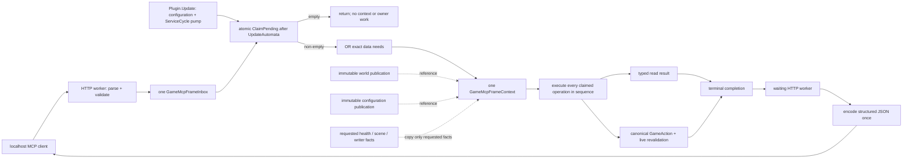

# Game MCP frame operations

> **Lifecycle: Accepted perf-debug architecture.** The Game MCP is a thin localhost transport into
> one request-scoped Unity-frame operation boundary. It owns no shadow world, update cadence,
> gameplay scheduler, or permanent action authority.

[Back to dossier](README.md) · [Game boundary doctrine](game-boundary-doctrine.md) ·
[Shared world collection](world-collection.md) · [MCP tools](../development/mcp-tool-reference.md)

## Frame boundary

Each request asks the next Unity frame to perform exactly its declared operation. Shared world facts
stay in their publication; request-specific native/UI facts are read only for that request.

## Request flow

`GameMcpFrameExecutor` owns the frame loop: `Plugin.Update` calls its `Drain` after
`UpdateAutomata`, and the `GameMcpFrameBatchExecutor.Drain` inside it is the only claim site, so the
context observes the configuration and ServiceCycle publications accepted for that frame. The same
`Plugin.Update` then continues to Mentor and UI maintenance after the MCP batch.

## Exact frame and concurrency semantics

1. Each validated stateful `tools/call` or dynamic `resources/read` submits one immutable
   `GameMcpFrameOperation` to `GameMcpFrameInbox` and waits on that operation's completion.
2. `ClaimPending` locks once, claims the complete pending set, and preserves assigned submission
   sequence. There is no item cap, priority queue, or backlog policy.
3. An operation submitted after the claim is not in the claimed array and belongs to the next
   frame. It is neither lost nor allowed to overtake an earlier operation.
4. The executor ORs the claimed operations' `GameMcpFrameData` flags and constructs exactly one
   context. The context holds the already-immutable world and configuration publication references;
   it does not clone them.
5. Claimed operations execute sequentially. Every read sees the pinned initial context. Every
   gameplay action also performs its canonical live native revalidation, so a later action sees a
   native mutation committed by an earlier action in the same batch.
6. Emergency stop has no scheduler priority. It takes effect at its submitted position. Once it
   executes, synchronous cancellation and native admission close before the following operation.
7. Parameterized UI/native reads run only in their named operation. Multi-frame UI operations
   (navigation and end-of-frame framebuffer capture) retain their original pinned context and own
   completion until their terminal callback.
8. A committed gameplay operation retains terminal ownership while one shared settlement coroutine
   waits up to one second for a world strictly newer than its admission world. Every gameplay kind
   settles through the post-state rule its `GameMcpCommandCatalog` descriptor registers: the shared
   readiness predicate, strengthened only where the requested outcome itself must be visible
   (casting dials, cast fires, structure toggles, concept and research amounts, discovery offer
   transitions), and the kind's own command-to-world projector.
   If the deadline expires, one shared `postStateUnavailable / post_state_timeout` shape replaces
   the otherwise empty committed body, except a cast fire, which answers with the facts its own
   boundary sentinel proved; ordinary fresh responses carry no settlement marker.

### Cancellation and shutdown

- **Before claim:** the HTTP wait may atomically transition a pending operation to terminal
  `request_canceled_before_claim`. `ClaimPending` omits it, so no Unity handler or mutation can run.
- **After claim:** cancellation loses ownership. The HTTP worker waits without a second timeout for
  the actual terminal result. A client cannot receive a timeout while a hidden mutation executes
  later. That missing deadline is the design and not an oversight: an answer about an operation
  still running on Unity's main thread is exactly the unverified terminal outcome the boundary
  doctrine refuses, so an operation that does not come back is bounded inside itself — the tooltip
  walk's depth and visit caps are the worked example — rather than cut short from the socket.
- **Completion:** exactly one terminal result is legal; duplicate completion throws.
- **Shutdown:** closing the inbox completes every still-pending operation once with
  `suite_shutdown`. Already-claimed operations retain terminal ownership.

## Finite off-frame exception set

Only protocol mechanics and static schema discovery bypass the inbox. The
[protocol router](https://github.com/OrbAutomata/OrbOfCreation-ModSuite/blob/main/src/Automata/Runtime/GameMcp/GameMcpProtocolRouter.cs) owns that finite exception
set; it is not repeated as a method-name list here.

Every advertised stateful tool, including read-only tools, uses the inbox. The HTTP router does not
read `WorldPublication`, `ConfigurationPublication`, owner registries, Unity objects, or gameplay
state.

## Responsibility table

| Concern | HTTP worker | Unity frame operation |
| --- | --- | --- |
| HTTP headers, loopback/origin checks, body size | Owns | Never |
| JSON-RPC/MCP parsing and request-shape validation | Owns | Never |
| Tool/resource static schema enumeration | Owns | Never |
| Immutable operation submission and terminal wait | Owns | Completes |
| World/configuration publication selection | Never | Pins existing references once |
| Feature/service/trace health owner reads | Never | Only when requested |
| Scene, tooltip, screen, probe, framebuffer reads | Never | Only for the named operation |
| Requirement/cost/recipe explanation | Never | Evaluates typed data from one context |
| Gameplay policy and mutation | Never | Canonical GameAction only |
| General JSON serialization/reflection projection | Owns, after completion | Executably forbidden |
| MCP response/socket write | Owns | Never |

[GameMcpFrameThreadBoundary](https://github.com/OrbAutomata/OrbOfCreation-ModSuite/blob/main/src/Automata/Runtime/GameMcp/GameMcpFrameOperation.cs) makes the JSON/protocol half executable: encoding, reflective object
projection, or protocol routing attempted during frame execution throws and becomes an exact typed
operation fault. Unity creates only native-free `GameMcpValue` documents.

## Data-lifetime and owner inventory

Each exposed datum has one declared owner and lifetime. Shared world data comes from the existing publication at the configured collection pace, not an MCP cadence. Request-time data belongs to one claimed Unity operation and is not retained as an MCP snapshot.

The [tool catalog](https://github.com/OrbAutomata/OrbOfCreation-ModSuite/blob/main/src/Automata/Runtime/GameMcp/GameMcpToolCatalog.cs) owns build-time operation metadata;
[capability descriptors](https://github.com/OrbAutomata/OrbOfCreation-ModSuite/blob/main/src/Automata/Runtime/GameMcp/GameMcpEntityCapabilityMap.cs) own category/type/projection metadata.
The [world collector](https://github.com/OrbAutomata/OrbOfCreation-ModSuite/blob/main/src/Common/Runtime/World/GameWorldCollector.cs) owns authored-versus-live
classification, as explained by [world collection](world-collection.md#layout). These inventories
are linked rather than mirrored in a second field table.

A frame context pins existing immutable world/configuration publications by reference. Requested
health/writer facts are copied from their typed owners only when requested. Parameterized tooltip,
screen, navigation, probe and framebuffer operations perform their named read on Unity and return
native-free results. UI changes retain their declared mutation classification. No request starts a
periodic cache or creates another world publication.

Authored requirements use [the shared reader](https://github.com/OrbAutomata/OrbOfCreation-ModSuite/blob/main/src/Common/Runtime/World/Categories/WorldEntityRequirementReader.cs)
and [iterative fold](https://github.com/OrbAutomata/OrbOfCreation-ModSuite/blob/main/src/Common/Runtime/World/WorldRequirementEvaluator.cs). Their live verdicts
come from the pinned publication. A request does not re-traverse a structural graph from HTTP or
interpret a missing required container as satisfied. Crafting authoring uses
[its actual binder](https://github.com/OrbAutomata/OrbOfCreation-ModSuite/blob/main/src/Common/Runtime/World/Categories/WorldCraftingRecipeType.cs), alongside
live crafting projections; no separate reader-type roster is maintained here.

## Gameplay ownership

The listener and an empty inbox acquire no action-family lease. A claimed gameplay operation asks
`AutomataActionFamilyOwnership.TryBeginGameMcpOperation` for only its mapped family, holds that scope
around one `GameMcpCommandDispatcher.ExecuteGameMcp` call, and releases it immediately. The
dispatcher runs the executor the kind's `GameMcpCommandCatalog` descriptor registers, which
delegates to the same purchase, cast, concept, harvest, spell-level, discovery, loadout, crafting,
equipment, research, challenge, prestige, targeting, or consumable GameAction used by
features/tests. MCP capability registration is independent of whether an automation consumer is
configured on. UUID category and expected native type come from the one
`GameMcpEntityCapabilityMap` used by both read validation and action admission.

## Minimal terminal protocol

Reads use `available`/`unavailable` and the requested rows from one pinned world. Mutations use
`committed`/`refused`/`faulted`; success returns only the settled delta and omits a code that would
merely repeat `committed`. Failure adds one stable `code`, one actionable `reason`, and only the
identity or outcome fact that made that reason true; it does not assemble a general-purpose
receipt. No result exposes a world generation. The exceptional case where a committed outcome
cannot be observed in a world captured after the action within one second retains `committed` plus only
`postStateUnavailable` with the sentence naming it; it never substitutes the older world. Every
result is one page of text in `content`, emitted once beside any image media, and no result carries
a `structuredContent` copy. Committed, refused, and faulted GameAction results are all successful MCP tool
executions, so `isError` stays false and the domain result reaches the client. `isError` is reserved
for failures that occur before a canonical domain result exists, such as frame-operation dispatch
failure.

The protocol does not expose submission/processing/responded/captured timestamps, queue occupancy,
queue capacity, priority, operation sequence, pending handles, receipt IDs, or snapshot tokens.

Collection partiality is localized only from published evidence. In particular, an unknown
entity-requirement leaf is owner-local when the published unknown rows exactly reconcile with the
collector's skipped count. Reads and searches over other owners remain authoritative; any result
touching that owner carries the partial row plus its UUID, container, ordinal, runtime condition
type, and collector reason. An unreconciled skipped count remains category-global and fail-closed.

## Hard boundary

This code exists only under `SERVICE_CYCLE_PROFILE`, listens only on IPv4 loopback, and is a debug
tool rather than a production control plane. Unity and game APIs stay on Unity's main thread.
Gameplay changes use GameActions. Navigation, tooltip opening, Continue, and tab selection are
truthfully UI state mutation, not read-only gameplay. `trace_health` is writer-health-only. Every
operation returns one inline terminal response; there is no polling or retained receipt API.
